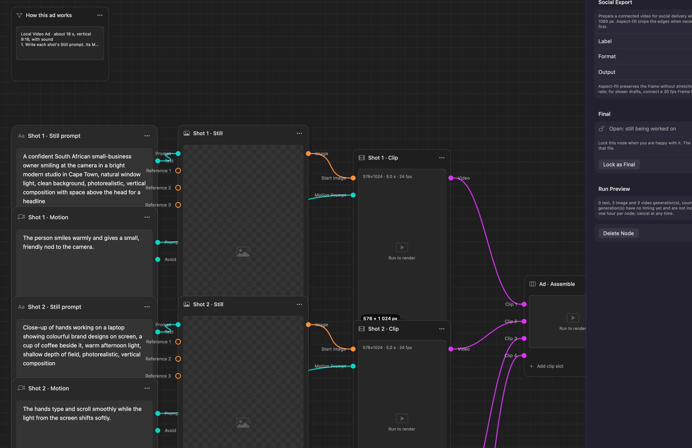
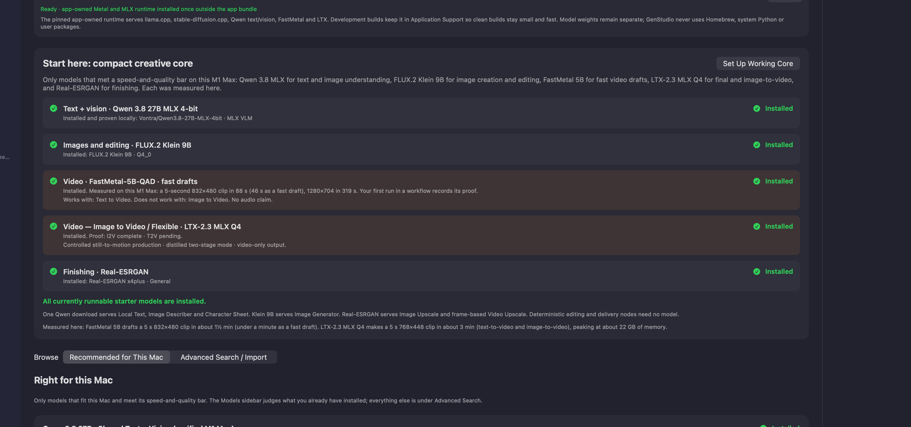

# GenStudio

> A local-first visual AI workflow studio for Apple Silicon Macs.

GenStudio is a native macOS application for building reusable node workflows that turn prompts and source media into text, images, and video. It was created as a personal experiment: can useful local generation run on one creator's own Mac, with their own models and files, rather than depending on a hosted service or another installed AI application?

The answer is a creator-oriented canvas with explicit model compatibility, local execution, durable project files, retained outputs, and provenance. Network access is used only to discover and download models; compatible installed models continue to run locally afterward.

> **Source-release status:** This is a free, source-first technical preview. It contains the macOS app source, tests, and documentation, but it deliberately does **not** contain model weights or the large local-inference runtime. A fresh clone can compile and run the test suite; generation requires a future, independently reviewed runtime bootstrap. See the [release guide](docs/OPEN_SOURCE_RELEASE.md).



*A real Start Video Ad workflow in GenStudio: prompts and directed motion feed local image/video nodes, then flow into assembly and social delivery.*

## What GenStudio does

- builds visual text, image, and video workflows from typed, named nodes;
- runs compatible local models on Apple Silicon through app-owned engines and a pinned runtime;
- keeps project files, run history, takes, artifacts, and generation provenance locally;
- combines local AI generation with deterministic image/video editing, assembly, captions, end cards, voiceover, and social export;
- makes model/task readiness visible instead of silently changing the requested model or falling back to a cloud service.

## Built for visual workflow authoring

GenStudio is not just a list of generators. Its canvas is designed to make the creative intent and the path from input to export understandable at a glance.

- **Image Prompt** turns an idea into an image-ready prompt with the controls relevant to the chosen image route.
- **Video Prompt** turns a shot idea into a directed motion prompt: action, camera move, focus, look, pace, and sound are explicit instead of buried in a paragraph.
- **Prompt Enhancer** sits between a rough prompt and its destination. It uses a local model to tailor the wording to an image, image-to-video, text-to-video, or voiceover task while retaining the original creative intent.
- **Typed image and video nodes** make media flow visible. Named ports, reference sockets, ordered repeatable inputs, and output fan-out prevent silent mismatches.
- **Organise Nodes** lays out a selected flow or an entire workflow into readable rows and columns without discarding the graph's connections.
- **Production nodes** carry work through to delivery: image generation, image-to-video, text-to-video, frame extraction, upscaling, interpolation, stitching, captions, end cards, voiceover, and social export.

The [node reference](docs/NODE_REFERENCE.md) explains all 49 current node kinds, their inputs, outputs, and what each one is for.

## Local model library, not a black box

The Models view reports what is installed, what each route can do on this Mac, its capability evidence, storage requirements, and whether it is a fast draft, a final-quality option, or not suitable. It keeps local execution explicit rather than silently substituting a cloud provider or another model.



## Why it exists

GenStudio began as a personal side project inspired by the visual-workflow idea in [HeliosGen](https://github.com/SegFault42/HeliosGen). It then became a substantially different native macOS implementation shaped around the author's own workflow: local models and runtimes, richer node interaction, typed ports and graph validation, file saving and project handover, model compatibility/proof, retained media, deterministic finishing, and recoverable execution.

It is being shared so other people can inspect it, build on it, adapt it to their own machines, and take the experiment further.

## Current product

The app currently provides:

- a native SwiftUI/AppKit workflow editor with typed, named ports;
- project creation, duplication, auto-layout, undo/redo, and persistent canvas state;
- proof-gated model search, pinned complete-package downloads, import, validation, updates, and resumable transfers;
- local text, vision, image, video (LTX-2.3 clips with generated sound), interpolation, upscaling, media-processing, assembly, end-card, and export paths;
- a Start Video Ad template for 9:16 adverts: stills, camera-directed motion with sound, an End Card with logo and contact details, and a 1080×1920 export;
- advert finishing: a Brand Kit, Text Overlay captions, dissolves and fades, a music track under the whole video, a local Voiceover in a voice you describe, and Social Export in 9:16, 4:5, 1:1 or 16:9;
- queued execution, cancellation, recovery after interruption, run history, takes, and retained artifacts;
- explicit model/backend/task capability gates so an installed model is not automatically claimed to work for every task;
- an app-owned, self-contained Python/MLX runtime for the proven Qwen text/vision route, FastMetal T2V drafts, and native LTX-2.3 Q4 T2V/I2V, with no Homebrew, system-Python, CPU, or legacy LTX fallback. Debug installs this runtime once outside the app bundle; Release packages the signed runtime.

The canvas has 49 node kinds spanning prompts, local AI generation, deterministic image and video operations, routing/inspection, shot planning, and delivery. See the [node reference](docs/NODE_REFERENCE.md) for what each node does, [Product requirements](docs/PRD.md) for the supported journeys, and [Architecture](docs/ARCHITECTURE.md) for how execution works.

## Purpose and boundaries

Local generation is the product's foundation. OpenAI and Anthropic client code exists in the separate `ProviderKit` Swift package, but it is not linked into the macOS app or exposed as a canvas node today. `EngineKit` is also a separately tested extraction/prototype, not the implementation compiled into the app target.

GenStudio does not depend on Draw Things, ComfyUI, Ollama, or HeliosGen. The HeliosGen repository is credited as the original inspiration, but its code is not included, compiled, or shipped here. Not every Hugging Face repository is compatible, and model support must be established for an exact recipe, engine build, and task.

## Requirements

- Apple Silicon Mac running macOS 26 or later
- Xcode with Swift 6 support
- [XcodeGen](https://github.com/yonaskolb/XcodeGen)
- an app-owned runtime bootstrap (not yet included in a public clone—see the [release guide](docs/OPEN_SOURCE_RELEASE.md))
- enough free storage for selected models; model weights are not included in the app bundle

The project was developed around an M1 Max MacBook Pro with 64 GB unified memory. Capability limits and measured baselines in the source are evidence for that hardware, not universal performance promises.

## Build from source

The source is intended to compile and test on an Apple Silicon Mac with Xcode and XcodeGen. A public clone deliberately excludes the large app runtime and model weights: both need separate redistribution and licence review. Building the app does not make local generation available until a public runtime bootstrap is provided and verified.

## Build and run

```bash
script/build_and_run.sh run
```

The app can launch in Debug, but **Models → Start Here** cannot complete generation setup from this source release because the runtime payload is intentionally absent. `script/install_local_runtime.sh` likewise requires a separately supplied, reviewed runtime. Do not download or copy arbitrary runtimes into the app.

Other modes are `debug`, `logs`, `telemetry`, and `verify`. The script regenerates `GenStudio.xcodeproj` only when `project.yml` or the Swift source-file list changes, builds Debug in `.build/DerivedData`, and shares Swift package checkouts through `.build/SourcePackages`.

To build manually:

```bash
xcodegen generate --spec project.yml
xcodebuild -project GenStudio.xcodeproj -scheme GenStudio -configuration Debug \
  -destination 'platform=macOS,arch=arm64' -derivedDataPath .build/DerivedData \
  -clonedSourcePackagesDirPath .build/SourcePackages build
```

## Test

```bash
xcodegen generate --spec project.yml
xcodebuild -project GenStudio.xcodeproj -scheme GenStudio -configuration Debug \
  -destination 'platform=macOS,arch=arm64' -derivedDataPath .build/DerivedData \
  -clonedSourcePackagesDirPath .build/SourcePackages test
swift test --package-path EngineKit
swift test --package-path ProviderKit
```

Some real-model and network integration tests are opt-in and skip unless their documented environment variables and model files are supplied. A green unit suite proves the software contract; it does not replace a decoded-media proof for a model adapter.

## Repository map

| Path | Role |
|---|---|
| `GenStudio/` | macOS app source and the implementation compiled into the app target |
| `GenStudioTests/` | app unit, integration, persistence, workflow, and media tests |
| `project.yml` | XcodeGen source of truth for app build settings and dependencies |
| `script/` | build/run and native-runtime packaging scripts |
| `.vendor/` | intentionally absent from this source release; it held local runtime material that requires a separate redistribution review |
| `EngineKit/` | separately tested model-library extraction/prototype; not linked to the app |
| `ProviderKit/` | separately tested OpenAI/Anthropic client and Keychain code; not linked to the app |
| `docs/` | product, architecture, build, packaging, node, and public-release documentation |

## Documentation

Start with [Documentation index](docs/INDEX.md). The most useful documents are:

- [Product contract](docs/PRODUCT.md)
- [Product requirements and intent](docs/PRD.md)
- [Architecture](docs/ARCHITECTURE.md)
- [Infrastructure and operations](docs/INFRASTRUCTURE.md)
- [AI development reference](docs/AI_DEVELOPMENT_REFERENCE.md)
- [Node reference](docs/NODE_REFERENCE.md)
- [AI workflow-authoring briefing](docs/ai-authoring/README.md)
- [Packaging and distribution](docs/PACKAGING.md)

For an AI coding agent, begin with [AGENTS.md](AGENTS.md). For a portable context prompt to paste into another model, use the copy-ready section in [AI_DEVELOPMENT_REFERENCE.md](docs/AI_DEVELOPMENT_REFERENCE.md).

The exact scope and limitations of the first public snapshot are in [RELEASE_NOTES.md](RELEASE_NOTES.md).

## Attribution and licences

GenStudio gives credit to [HeliosGen by SegFault42](https://github.com/SegFault42/HeliosGen), whose open visual-workflow project sparked this personal experiment. Its ideas informed the original direction; GenStudio's native macOS app target is separately implemented and does not include, compile, or ship HeliosGen code.

GenStudio-authored source code is available under the [MIT License](LICENSE). This grants broad freedom to use, modify, distribute, and sell derivative work while retaining the licence notice and warranty disclaimer. It does not replace the separate terms for upstream runtimes, copied/adapted material, or model weights. See [ATTRIBUTIONS.md](ATTRIBUTIONS.md) and the [open-source release guide](docs/OPEN_SOURCE_RELEASE.md).

## Contributing and support

This repository is a source-first technical preview. Contribution, support, security, and community guidance is in [CONTRIBUTING.md](CONTRIBUTING.md), [SUPPORT.md](SUPPORT.md), [SECURITY.md](SECURITY.md), and [CODE_OF_CONDUCT.md](CODE_OF_CONDUCT.md).

## Current release posture

Version `0.1.0` build `1` is configured in `project.yml`. Debug and local Release packaging are supported. Release enables Hardened Runtime and bundles the pinned runtime, but Developer ID signing and notarization still require a Developer ID Application certificate and notary credentials. App Sandbox is currently disabled.

Last reviewed against source and tests: 18 September 2026.

---

<p align="center"><sub>Made by Neil de la Harpe · <a href="https://skilld.design/?utm_source=github&utm_medium=readme&utm_campaign=genstudio">Skilld Design</a></sub></p>
